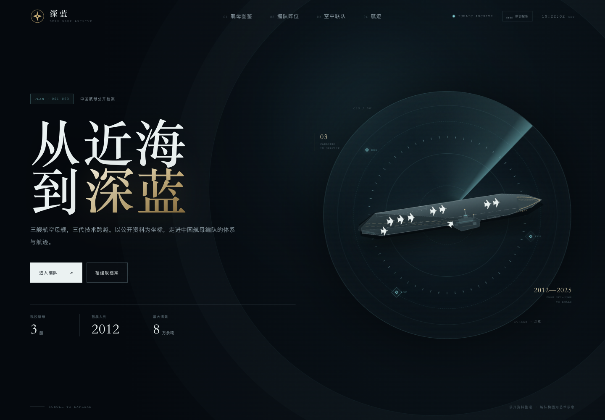
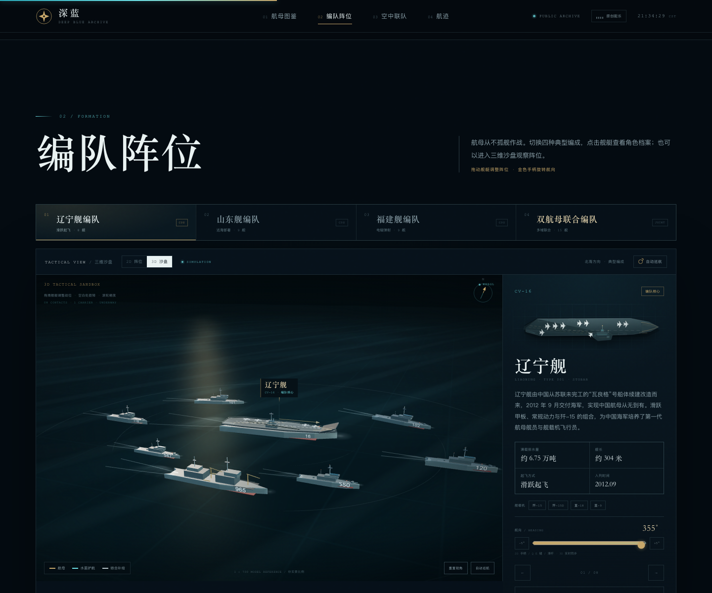
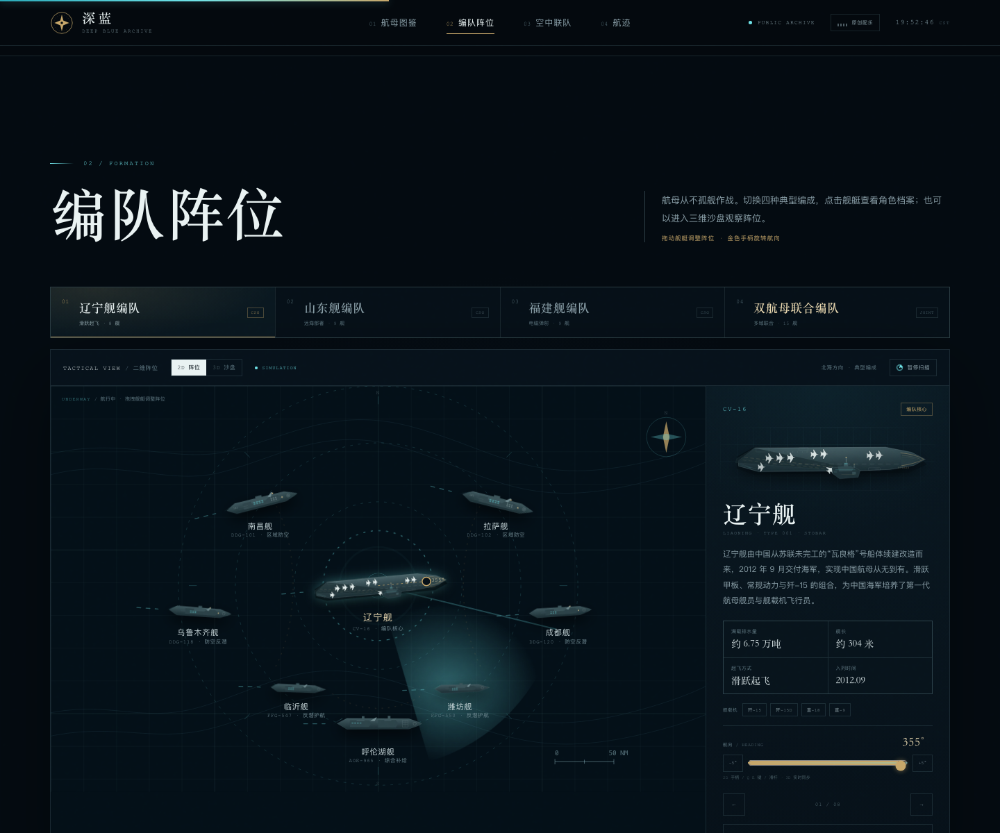

# 深蓝档案 · 中国航母编队







一个无需构建、可直接运行的单页交互式科普网站原型。以深海蓝、信号青与仪式金为视觉基调，展示中国三艘航空母舰、四种典型编队、可旋转的三维沙盘、舰载机与公开发展时间轴。

## 运行

```bash
cd /Users/gers/Documents/deepseek-harness/default-workspace
python3 -m http.server 8123
# 打开 http://127.0.0.1:8123
```

静态文件可以直接部署到任意静态托管（GitHub Pages / Netlify / Vercel）。三维模块按需加载；页面默认使用 2D 阵位以保证公开部署和手机访问的稳定性，点击「3D 沙盘」后载入 `vendor/` 下的 Three.js 进入完整航行视角。

## 手机访问

电脑和手机连接同一 Wi-Fi / 热点后，运行：

```bash
./start-lan.sh
```

脚本会打印类似 `http://172.20.10.2:8123` 的手机访问地址。手机浏览器打开该地址即可；iOS Safari 可通过分享菜单「添加到主屏幕」。

如果手机打不开，依次检查：

1. 电脑和手机是否在同一网络，且 Wi-Fi 未开启“客户端隔离”
2. macOS 防火墙是否允许 Python 接收连接
3. 地址是否是电脑的局域网 IP，而不是 `127.0.0.1`
4. 端口 `8123` 是否被其他程序占用

需要给不在同一网络的人访问时，建议把整个目录部署到 Netlify / Vercel / GitHub Pages，而不是直接暴露本地端口。

## 编队方案

- 辽宁舰编队：滑跃起飞，8 舰
- 山东舰编队：远海部署，9 舰
- 福建舰编队：电磁弹射，9 舰
- 双航母联合编队：参考用户提供的 1:700 双航母布局图，15 舰（含 075、071、054B 与潜艇，并补入 901 补给舰）

每种方案都可以在「2D 阵位」和「3D 沙盘」之间切换，右侧档案会跟随选中的舰艇更新。

## 交互

- 航母卡片：点击打开完整舰船档案
- 编队方案：点击上方方案切换阵容，2D / 3D 同步更新
- 3D 沙盘：拖拽舰艇调整战位；空白处拖拽旋转、滚轮缩放、点击舰艇选择；支持重置视角与自动巡航
- 航行演示：2D 阵位带流动尾迹；点击「3D 沙盘」进入完整航行视角，包含海浪、尾迹、舰艏浪、舰体横摇与航向指示线，HUD 显示 UNDERWAY
- 2D 阵位图：带流动尾迹的航行阵位；直接拖拽舰艇调整战位；点击舰艇切换右侧角色档案，支持键盘 Enter / Space
- 自由阵位：2D / 3D 拖动双向同步，自动写入 localStorage；点击「恢复阵位」回到默认布局
- 航向调整：2D 金色手柄拖动旋转，右侧滑杆、±5° 按钮或 Q / E 键精确调整；3D 航向实时同步并显示罗盘指示线
- 原创配乐：右上角音轨按钮播放 / 暂停 Web Audio 合成配乐
- 顶部导航：滚动高亮、移动端全屏菜单
- 预置 PWA manifest，可添加到手机主屏

## 文件

- `index.html` — 页面结构、内联 SVG 舰船与舰载机图形库
- `styles.css` — 视觉系统、布局、动效与响应式
- `app.js` — 舰船 / 编队数据、2D 阵位、档案弹层、视图与音乐控制
- `scene3d.js` — Three.js 三维沙盘、程序化舰船模型、海洋与相机交互
- `music.js` — 原创 Web Audio 配乐《向海》
- `vendor/` — 本地化的 Three.js、OrbitControls 与 RGBELoader，避免运行时依赖 CDN
- `assets/hdri/` — CC0 日落天空 HDRI，用于 PBR 环境反射
- `assets/refs/` — 实景参考图片与 `CREDITS.md`
- `assets/icon.svg`、`manifest.webmanifest` — PWA 图标与清单

## 渲染升级

三维场景使用 PBR 舰体材质、程序化甲板/舰体纹理、HDRI 环境反射、方向光阴影、海水菲涅耳反射与太阳高光、舰艏浪/尾迹、舰体编号与甲板细节。桌面端默认开启阴影与高精度渲染；移动端自动降低阴影/像素比。

HDRI 环境来自 Poly Haven 的 CC0 日落天空；实景照片与 HDRI 的完整许可见 [assets/refs/CREDITS.md](assets/refs/CREDITS.md)。

当前舰体仍是程序化低模，升级后的观感为“游戏级”，不是照片级。要接近照片级，需要替换为高精度 glTF 模型（购买/授权或 Blender 定制），再配合 4K PBR 贴图、法线/粗糙度贴图与手工 UV。

## 实景图片与三维模型

参考图片来自 Wikimedia Commons，均为 CC 许可，详见 [assets/refs/CREDITS.md](assets/refs/CREDITS.md)。照片用于核对舰体比例、舰岛位置、甲板标线与涂装；三维模型为原创程序化低多边形重建，未直接使用照片作为舰体 UV 贴图，也不代表官方模型或真实部署。

## 关于音乐

页面中的配乐《向海》为原创合成氛围音乐，使用 Web Audio 实时生成，不包含《人民海军向前进》的旋律或录音。若要在项目中使用正式军歌录音，请先确认音频授权，然后把授权音源提供给项目替换；仓库中未内置受版权保护的军歌音频。

## 说明

本项目为非官方科普概念作品。航母、舰艇参数来自公开报道与公开估算，编队舰名和阵位为艺术化组合，不代表真实任务编组或官方立场。
